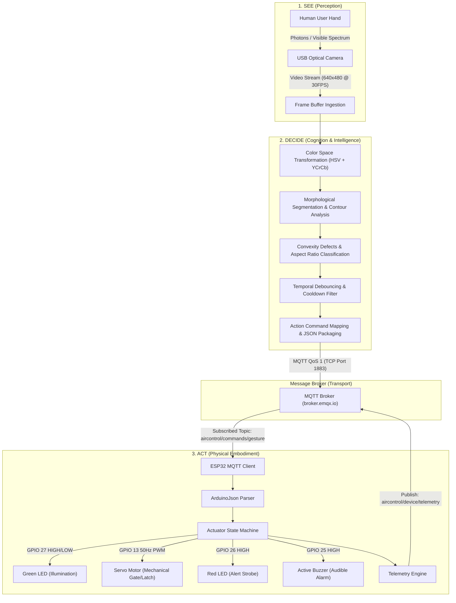
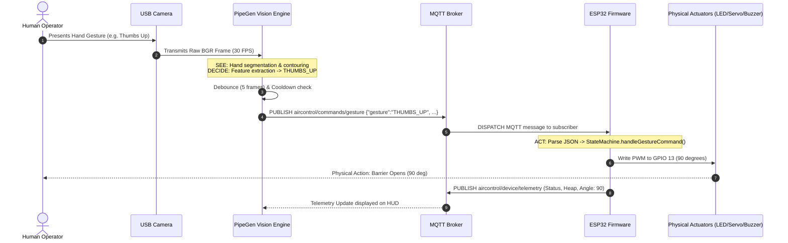
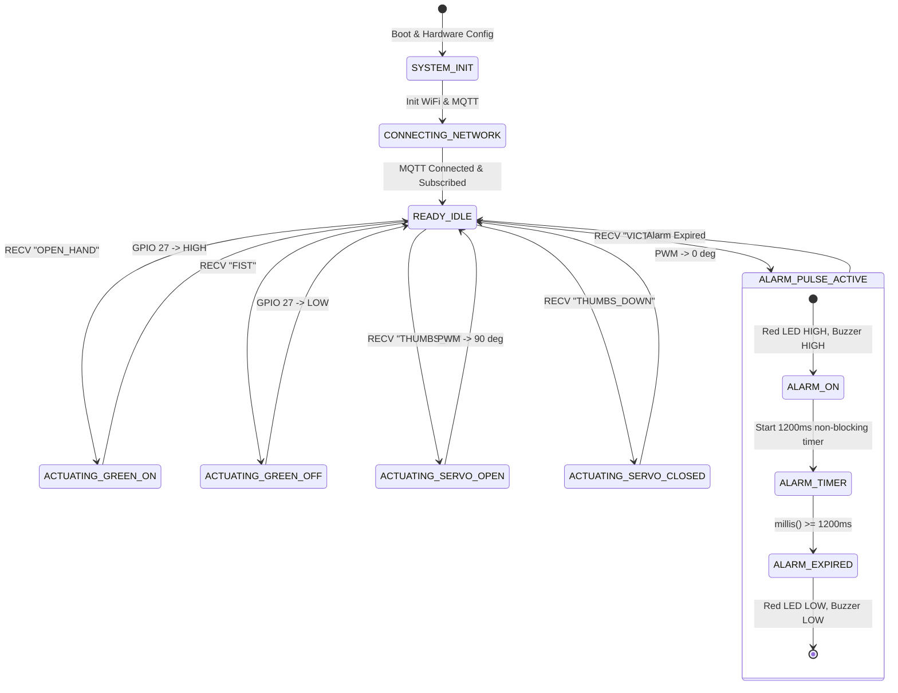

# AirControl AI - System Design Document (SDD)

**Document Version:** 1.0.0  
**Status:** Approved  
**Classification:** Technical Architecture & Design Document  

---

## 1. System Architecture

AirControl AI demonstrates the complete **Physical AI** loop: **See → Decide → Act**.



---

## 2. Sequence Diagram (End-to-End Gesture Actuation)



---

## 3. Hardware Schematic & Pin Mapping

### 3.1 Actuator Pinout Table
| Actuator Component | Function / Role | ESP32 GPIO | Drive Interface | Electrical Characteristics |
| :--- | :--- | :---: | :--- | :--- |
| **Green LED** | Power / Status Indicator | **GPIO 27** | Direct Digital Out | 3.3V Logic through 220Ω current-limiting resistor (~10 mA) |
| **Red LED** | Warning / Alarm Strobe | **GPIO 26** | Direct Digital Out | 3.3V Logic through 220Ω current-limiting resistor (~10 mA) |
| **Active Buzzer** | Audible Warning Beep | **GPIO 25** | Direct Digital Out / NPN Transistor | 3.3V Logic or 5V rail switched via 2N2222 / S8050 NPN driver |
| **Micro Servo (SG90/MG90S)** | Physical Mechanical Actuator | **GPIO 13** | Hardware PWM (ESP32PWM) | 50 Hz PWM carrier, 500µs (0°) to 2400µs (180°), powered via 5V rail |

### 3.2 Electrical Wiring Diagram
```
    ┌──────────────────────────────────────────────┐
    │             ESP32 DEVELOPMENT BOARD          │
    │                                              │
    │   [GPIO 27] ──────[ 220Ω ]──────( Green LED )─┐
    │                                              │
    │   [GPIO 26] ──────[ 220Ω ]──────(  Red LED  )─┤
    │                                              │
    │   [GPIO 25] ───────────────────( Active Buzz )┤
    │                                              │
    │   [GPIO 13] ────────[ PWM Signal ]──────────┐│
    │                                             ││
    │   [  GND  ] ────────────────────────────────┼┴──── (COMMON GROUND)
    │   [  VIN  ] ───────( +5V DC Rail )──────────┼───── (SERVO +5V VCC)
    │                                             │
    │                     ┌───────────────────────┘
    │                     ▼
    │            ┌─────────────────┐
    │            │ SG90 SERVO MOTOR│
    │            │ Orange : PWM    │
    │            │ Red    : +5V    │
    │            │ Brown  : GND    │
    │            └─────────────────┘
    └──────────────────────────────────────────────┘
```

---

## 4. MQTT Protocol Architecture

### 4.1 Topic Hierarchy
```
aircontrol/
├── commands/
│   └── gesture         [QoS 1] Direction: PipeGen -> ESP32
└── device/
    ├── status          [QoS 1, Retained] Direction: ESP32 -> Broker / Clients (LWT)
    └── telemetry       [QoS 0] Direction: ESP32 -> Broker / PipeGen HUD
```

### 4.2 Message Schemas

#### Command Topic (`aircontrol/commands/gesture`)
```json
{
  "gesture": "THUMBS_UP",
  "timestamp": "2026-10-16T18:00:00Z"
}
```

#### Device Status Topic (`aircontrol/device/status`)
*Online Notification (Retained):*
```json
{
  "device_id": "ESP32_AIRCONTROL_DEV01",
  "status": "ONLINE",
  "firmware_version": "1.0.0-firmgen",
  "ip_address": "192.168.1.105",
  "mac_address": "24:6F:28:XX:YY:ZZ"
}
```
*Offline Notification (Last Will & Testament - Retained):*
```json
{
  "device_id": "ESP32_AIRCONTROL_DEV01",
  "status": "OFFLINE"
}
```

#### Telemetry Topic (`aircontrol/device/telemetry`)
```json
{
  "device_id": "ESP32_AIRCONTROL_DEV01",
  "uptime_ms": 125430,
  "wifi_rssi": -58,
  "free_heap_bytes": 184512,
  "actuators": {
    "green_led": true,
    "red_led": false,
    "servo_angle": 90,
    "buzzer_active": false
  },
  "metrics": {
    "commands_received": 14,
    "commands_executed": 14,
    "last_gesture": "THUMBS_UP",
    "last_command_time_ms": 124900,
    "execution_latency_ms": 12
  },
  "timestamp": "2026-10-16T20:56:23Z"
}
```

---

## 5. Actuator State Machine Design

The firmware maintains an explicit deterministic finite-state machine (FSM).



---

## 6. Fail-Safe & Watchdog Mechanisms
1. **MQTT LWT (Last Will & Testament):** Guarantees that any abrupt loss of connectivity (power failure or WiFi drop) immediately informs supervisory dashboards.
2. **Non-Blocking Execution:** No `delay()` operations exist in the main loop; all timers rely on `millis()` timestamps.
3. **Out-of-Range Clamping:** Servo angles outside [0, 180] are clamped to safe structural bounds.
4. **Buffer Overrun Protection:** `ArduinoJson` static memory allocations prevent heap fragmentation on the microcontroller.
